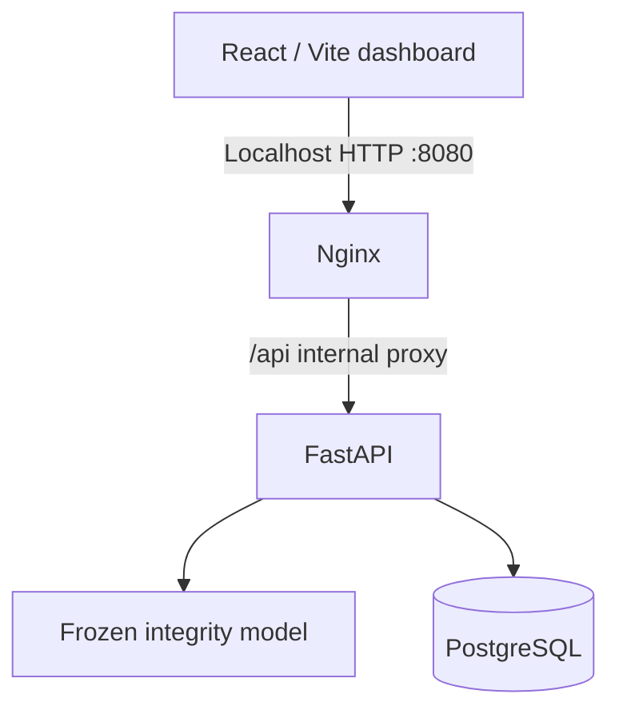

# Grid Sentinel — private smart-grid research platform

A complete **React + TypeScript + FastAPI + PostgreSQL** research dashboard for the frozen three-phase meter-consistency detector. It is designed for one private PC/server and packaged as a three-service Docker Compose stack. It is **not** a production-qualified electricity-grid intrusion detection system.

## Architecture



- **Frontend:** responsive operations dashboard, data ingestion, charted activity, finding history, **historical research evidence** and model transparency.
- **Backend:** FastAPI 3-phase integrity inference with strict timestamp and measurement validation, persisted analysis summaries, and readiness checks. Interactive `/docs` and public OpenAPI endpoints are intentionally **disabled** in the private deployment. The inference head is copied from the previously tested frozen Python service.
- **Database:** PostgreSQL 17 stores run metadata and derived findings. **Raw meter measurements are not stored**.
- **Ingress:** Nginx serves React and proxies API calls. Only `127.0.0.1:8080` is published on the host; PostgreSQL and FastAPI are internal containers.

## Quick start — Windows PC (Docker Desktop)

1. Install and start [Docker Desktop](https://docs.docker.com/desktop/setup/install/windows-install/) with the WSL 2 backend if needed.
2. Extract this project ZIP into a folder, e.g. `Documents\GridSentinel`.
3. Open **PowerShell** in the extracted `smartgrid_platform` directory.
4. Create a local environment file:

   ```powershell
   Copy-Item .env.example .env
   notepad .env
   ```

   Replace `REPLACE_WITH_A_LONG_RANDOM_PASSWORD` with a strong unique password. Also replace `REPLACE_WITH_A_LONG_RANDOM_ACCESS_TOKEN` with a **different**, cryptographically random access token (40+ characters). On Windows with Python installed, generate one using:

   ```powershell
   python -c "import secrets; print(secrets.token_urlsafe(48))"
   ```

   Copy that generated token into your local `.env`. Do **not** commit or share `.env` or paste either secret into public logs or messages.

5. Build and start the stack:

   First run the Phase 43 **static, offline** deployment preflight from this directory (Python required):

   ```powershell
   python -m pip install -r requirements-preflight.txt
   python scripts/deployment_preflight.py
   ```

   It fails if `.env` is missing, either password/token placeholder remains, authentication is disabled, secrets are duplicated, the frontend port is not loopback-only, database/backend ports are exposed, or critical security settings/files are missing. It never starts containers and it **does not** verify your Docker installation, actual host firewall, Postgres recovery, or grid security. The successful status reads `STATIC_PREFLIGHT_PASS_NOT_DEPLOYED`.

   Then build and start the stack:

   ```powershell
   docker compose up --build -d
   docker compose ps
   ```

6. After the three services are healthy, open **http://127.0.0.1:8080** in your browser. The React login asks for the private access token from `.env`. The token is retained only in browser-tab memory, never embedded in the JavaScript bundle or sent as a URL parameter; reloading/signing out requires entering it again. You can also check `http://127.0.0.1:8080/api/ready` to confirm the backend and database are responding.

7. Run the non-mutating smoke check from the project directory if Python is installed:

   ```powershell
   python scripts/smoke_check.py
   ```

   It checks loopback API health, PostgreSQL readiness, the frozen model status, and the warning on historical ARP evidence. It does not verify a browser session or database restore.

8. Run the stricter deployment acceptance check after the three services report healthy:

   ```powershell
   python scripts/deployment_acceptance.py --live
   ```

   This runs static configuration checks, validates the exact three Docker Compose service identities and their health, and performs read-only loopback API checks. Its success status is `LIVE_STACK_READ_ONLY_ACCEPTANCE_PASS`. It will **not** create or change database rows, restore backups, start/stop containers, or certify an actual grid deployment. The private `.env` and a running Docker Desktop are required. Without `--live`, the same command checks configuration only and explicitly reports `STATIC_ONLY_NOT_DEPLOYED`.

**Stop (preserves database):** `docker compose down`.

**Start again:** `docker compose up -d`.

**View logs:** `docker compose logs --tail=100 -f`.

Do not run `docker compose down -v` unless you explicitly want to delete the persistent PostgreSQL volume and its analysis history.

## What you can do

1. Open **Analysis lab**.
2. Upload a CSV or JSON with 1–1000 rows. Each row requires a timezone-aware ISO timestamp and measurements for five meters, each with `p_sum3`, `q_sum3`, `s_sum3`, and phase values `pln1...3`, `qln1...3`, `sln1...3`.
3. Or choose **Load synthetic demo data** to exercise the interface. This deliberately manipulates an internally consistent synthetic P total and is *not a real cyberattack*.
4. Run an assessment and review its findings in **Analysis history**. The Overview charts use recorded PostgreSQL data; they do not display fictional values.
5. Open **System & model** to see the frozen feature count, source hash, deployment scope and limitations.
6. Open **Research evidence** for the separately labeled, previously recorded S0–S6 research benchmark, including its clean false alarms, attack-family failures and selection caveats. These scores are not recomputed from newly uploaded runs.
7. The Research evidence page also includes **offline Modbus command-source audit outcomes** and a separately labeled five-second persistence sensitivity. The production API still only executes the frozen meter-consistency head on uploaded measurements. The protocol audit code is offline, read-only and **does not** collect live packets or authenticate device identities.
8. Phase 25 adds **offline ARP identity-claim consistency evidence** for S3–S5 MITM. The research view shows instantaneous and five-second sensitivity separately, including their increased false alarms. These results are not packet authentication and no ARP capture occurs inside the running app.
9. Phase 26 adds an **offline ARP alert-persistence sweep** (0–5 seconds) with row-level false alarms and benign alert episodes. The Research evidence view compares the 0-, 2-, and 5-second cases; the full JSONL sweep is included in the research handoff. No candidate threshold is deployed, and the dataset has already been inspected.
10. Phase 27 adds **non-ARP negative controls** using S0/S1/S1-alt/S2/S6 captures. The research page shows ARP packet counts, known-IP/MAC mismatches and benign alert burden, with an explicit same-topology limitation.
11. Phase 28 adds **uncertainty bounds for zero-alert observations**, prominently showing how assumed independent seconds, packets or scenarios imply radically different upper rates. None is approved as a field-performance estimate; no threshold was changed.
12. For backend tests on a clean virtual environment, install `backend/requirements-test.txt` (including pytest and the HTTPX test client) instead of production-only requirements.
13. Phase 29 bounds accepted measurement fields, rejects blank source identifiers and non-finite input, disables live API docs, and sets no-store/security headers and reverse-proxy CSP. Phase 62 adds **private bearer-token access** to all model/research/analysis endpoints plus a React login. Docker health/readiness endpoints remain available without a token so liveness checks can work. There is still no TLS, account management, or role-based authorization: keep the `127.0.0.1` Docker port binding private and do not expose this service publicly.
14. Phase 30 adds a localhost-only smoke test (`python scripts/smoke_check.py`) and an atomic, non-overwriting custom-format PostgreSQL dump (`python scripts/backup_db.py`). Phase 35 blocks redirects from the smoke check and adds `python scripts/verify_backup.py --backup backups/NAME.dump --sha256 SAVED_SHA256` to verify an archive against the SHA-256 independently recorded at backup time. Optionally add `--pg-restore-list` if `pg_restore` is installed. Phase 63 adds an explicit isolated restore drill described below. Backups are private data and are excluded from source releases. No actual Docker backup/recovery was run in the research environment.
15. Phase 31 adds a guarded Alembic baseline (`0001_grid_baseline`) executed at backend container startup. It initializes empty databases, validates and preserves compatible existing schemas, and halts on partial/drifted tables. Migrations have passed SQLite tests but not a real PostgreSQL container test here. Back up and rehearse restoration before rebuilding your stack.
16. Phase 32 adds synthetic ARP-maintenance identifiability evidence. A legitimate MAC change and a spoof with identical observed claims cause the same alerts. This requires independent authenticated inventory-change provenance before field promotion; do not auto-learn new MACs from suspicious ARP traffic.
17. Phase 43 adds `scripts/deployment_preflight.py` with read-only configuration checks and adversarial configuration tests. It is not a replacement for live Compose integration, PostgreSQL backup restore or authentication before network exposure.

## API contract

`POST /api/analyses` requires an `Authorization: Bearer <your-local-token>` header and accepts:

```json
{
  "source_name": "example.csv",
  "records": [
    {
      "timestamp": "2026-03-05T13:19:01+00:00",
      "values": {
        "PV-Inverter-AC-Meter.p_sum3": -5000.0,
        "PV-Inverter-AC-Meter.pln1": -1600.0
      }
    }
  ]
}
```

This snippet shows the shape only: a complete record needs **60** numeric meter fields. Missing fields cause `ABSTAIN`. The backend returns a summary and non-actionable review findings, never a verified attack verdict.

Other routes:

| Endpoint | Purpose |
|---|---|
| `GET /api/health` | Process liveness |
| `GET /api/ready` | Database and model readiness |
| `GET /api/model` | Frozen model details and scientific limitations |
| `GET /api/research-evidence` | Bundled offline Phase 22 benchmark, explicitly historical |
| `GET /api/protocol-research` | Bundled offline Modbus writer-role baseline and two-head comparison |
| `GET /api/protocol-sensitivity` | Bundled exploratory five-second persistence sensitivity, not deployed |
| `GET /api/arp-research` | Bundled, spoofable ARP-identity research, 0–5 second post-hoc policy sweep, non-ARP controls and assumption-sensitive uncertainty |
| `GET /api/overview` | Dashboard totals and 14-day trend |
| `GET /api/analyses` | Recent saved runs |
| `GET /api/analyses/{id}` | Saved findings and metadata |

## Tests and verification

Frontend production build:

```bash
cd frontend
npm ci
npm run build
```

Backend tests (Python 3.12; isolated environment recommended):

```bash
cd backend
python -m pip install -r requirements.txt pytest httpx
python -m pytest -q tests
```

Tests use a transient SQLite engine for API contract validation; the deployment uses **PostgreSQL**. This lets CI test endpoint semantics without connecting to real-grid equipment. Actual PostgreSQL/Compose integration needs a Docker-enabled host.

## Operational boundaries

- **Research-only scoring:** `LOCAL_PHYSICS_REVIEW` indicates a within-meter arithmetic inconsistency after three sequential readings, **not authenticated malicious activity**.
- **No OT network integration:** no connections to SCADA, substations, PLCs, MQTT brokers, PMUs, or electrical controls.
- **No live packet capture:** the new protocol evidence is historical research. Source IP roles are spoofable and are not cryptographic proof of a sender.
- **No public binding:** Compose exposes only the frontend on loopback. The private bearer token is a single-workspace gate, **not multi-user accounts, roles or Internet-grade access security**. No TLS is provisioned.
- **No model self-training:** calibration is frozen. Raw measurements are processed in memory and not saved by the database.
- **No automatic response:** the detector cannot trip, block, reconfigure, or attribute an attacker.
- **Readiness is not accuracy:** prior research found poor Modbus/MQTT generalization and insufficient independent real-world false-alarm validation.

Do not expose this stack on a public IP or connect it to grid equipment without an authentication layer, TLS, access controls, network isolation, threat modeling, operational acceptance tests and independent field validation.

## Backups and updates

The named `grid_sentinel_db` Docker volume persists on ordinary stop/start. Run `python scripts/backup_db.py` before meaningful upgrades, record its reported SHA-256 separately, and verify with `python scripts/verify_backup.py --backup PATH --sha256 DIGEST`. The backend executes the guarded Alembic baseline migration during container startup; partial/drifted existing schemas halt rather than silently changing data.

Phase 63 introduces a **separately authorized, isolated PostgreSQL restore drill**. On your private Docker host, with the stack running, replace the placeholders below with your backup filename and the SHA-256 independently saved when the backup was created:

```powershell
python scripts/restore_drill.py --backup backups/NAME.dump --sha256 SAVED_SHA256
python scripts/restore_drill.py --backup backups/NAME.dump --sha256 SAVED_SHA256 --execute
```

The first command checks the dump's format and digest **without contacting Docker**. The second explicitly creates a randomly named `grid_restore_drill_...` database, feeds the verified backup into `pg_restore --single-transaction`, checks that the `analysis_runs` and `findings` tables can be counted, then drops **only the test database created by that invocation**. It never restores into, drops, or renames `smartgrid`, the production database. If the process crashes, the throwaway database may remain and should be assessed manually; if cleanup fails, the drill reports failure. It does not reproduce all disaster-recovery conditions or prove data correctness beyond the two restored table counts. Keep the dump private and do **not** run `--execute` while unauthorized database maintenance is prohibited. A real Docker restore drill is still outstanding until you run this on your private machine.

## Current verification limits

The React production build and isolated FastAPI API tests passed in the research environment; rerun the test commands after modifying the release. The offline research acceptance workflow reproduced, though its scientific readiness decision remains incomplete. The environment **does not have Docker installed**, so Docker image build, PostgreSQL container startup, browser QA against the full stack, and deployment on your own PC must still be verified there. `scripts/deployment_acceptance.py --live` helps record that evidence without modifying stored analyses. The included model was trained only on the public Data4Cyber S0 benign profile and remains scientifically unqualified for grid operations.

No research paper was written.
